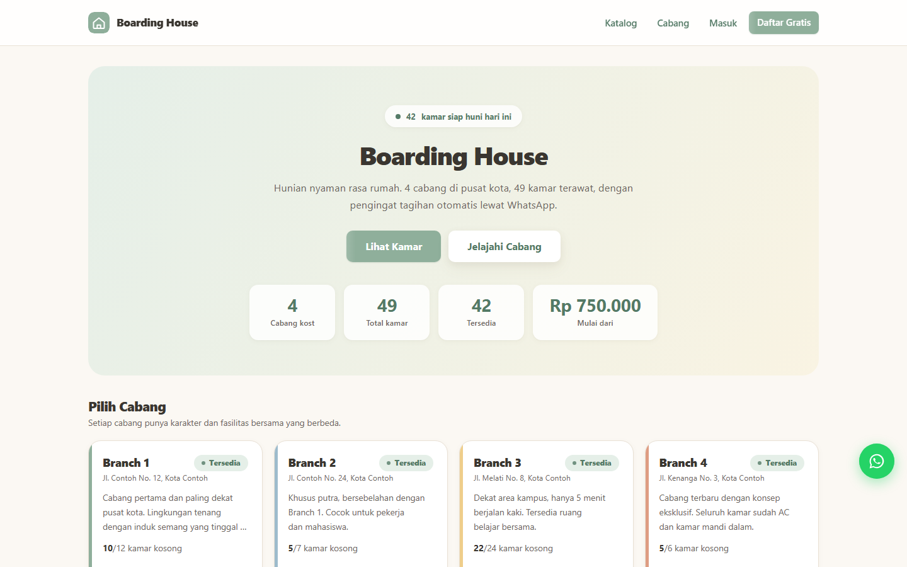
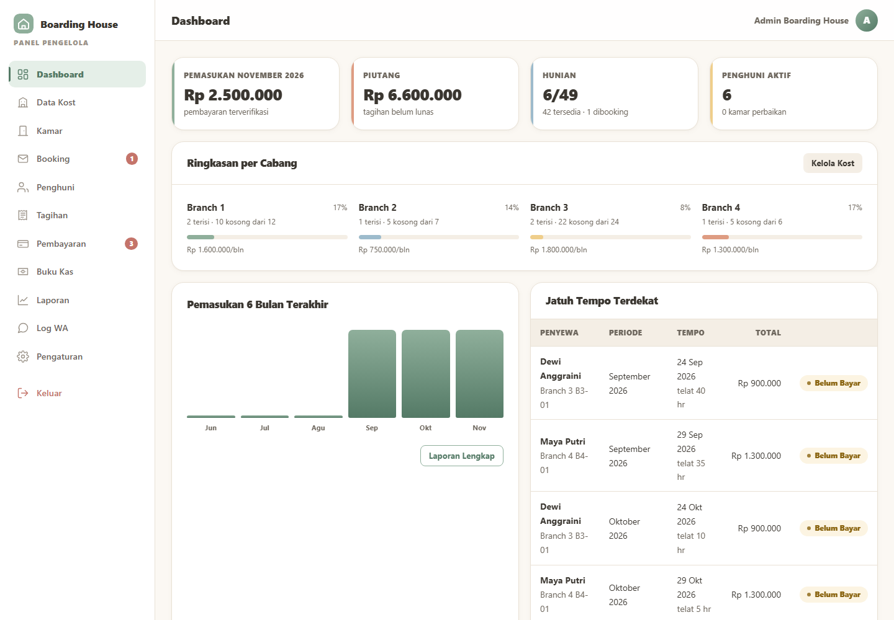
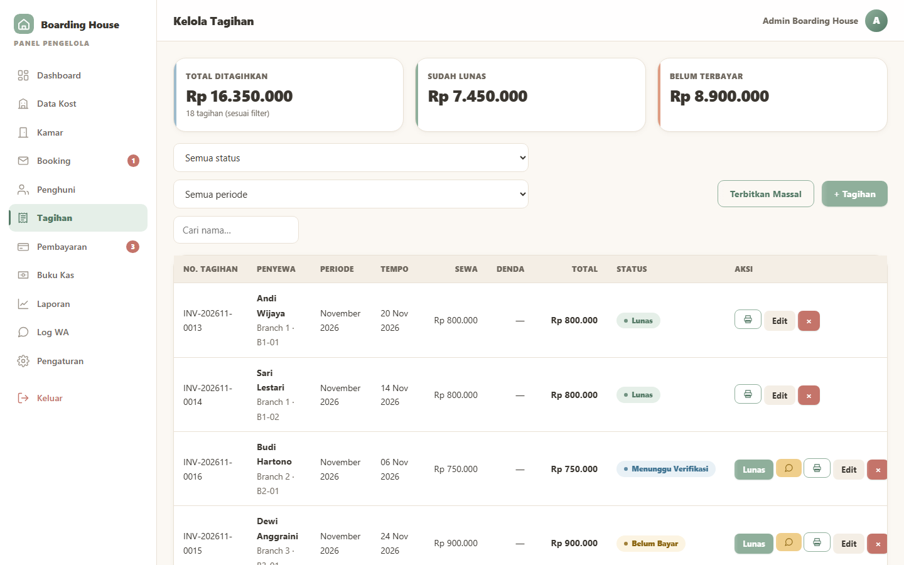
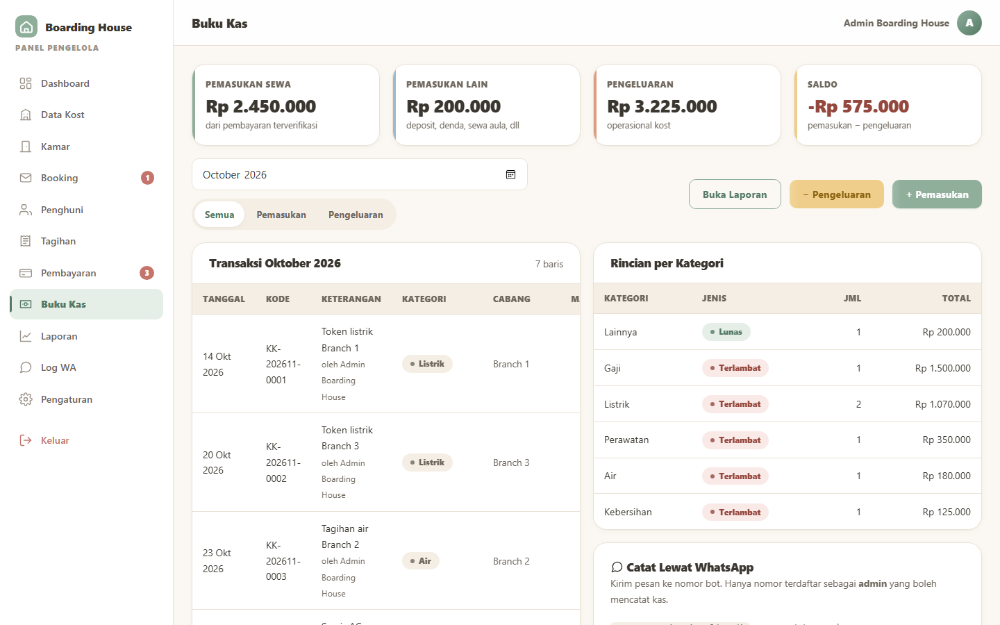
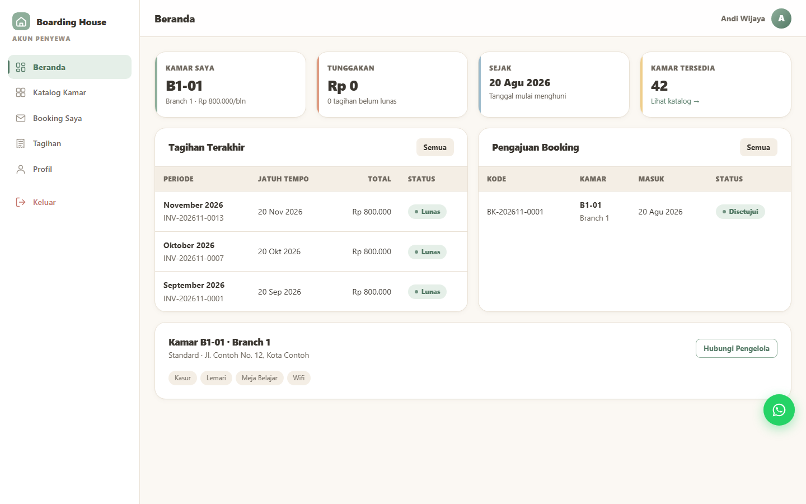

# Boarding House Management

Multi-branch boarding-house (kost) management system: room catalog with live availability,
tenant bookings, invoices and payment proofs, a cash ledger, and WhatsApp reminders.

PHP 8 (no framework, no Composer) · MySQL/MariaDB · plain HTML/CSS/JS.
The interface is in **Indonesian**. All data in this repository is **fictional demo data**.

## Features

- **Public catalog** — branches, rooms, prices and real-time availability (polled every 15 s).
- **Tenant area** — register with name + WhatsApp number, request a room, view invoices,
  upload payment proof, print a receipt.
- **Admin panel** — branches and rooms (CRUD, photo upload), booking approval, tenants,
  invoice generation, payment verification, cash ledger, financial reports (print / PDF),
  helpdesk contacts and settings.
- **WhatsApp automation** — reminder and late-fee jobs, incoming-message bot webhook.
  Drivers: `log` (default, nothing is sent), `fonnte`, `wablas`.
- **Google Sheets bridge (optional)** — Apps Script in `google/` mirrors the cash ledger.
- Security basics: PDO prepared statements, CSRF tokens, bcrypt, upload hardening via `.htaccess`.

## Screenshots

All screenshots show fictional demo data.

| Public catalog | Admin dashboard |
|---|---|
|  |  |
| **Invoices** | **Cash ledger** |
|  |  |

**Tenant area**



## Quick start (XAMPP)

1. Start **Apache** and **MySQL**.
2. Import `database/boarding_house_management.sql` (phpMyAdmin → *Import*, or
   `mysql -u root < database/boarding_house_management.sql`). It creates the database.
3. Open <http://localhost/boarding-house-management/>.

With no extra config the app uses XAMPP defaults (`root`, empty password, DB `boarding_house_management`).

### Demo accounts

Login uses the **WhatsApp number**, not email.

| Role   | WhatsApp       | Password   |
|--------|----------------|------------|
| Admin  | `628123456789` | `admin123` |
| Tenant | `628987654321` | `user123`  |

> Demo credentials only — change them before any real use.

## Configuration

Credentials are never stored in the code. Copy the example and edit it:

```
cp app/config.local.example.php app/config.local.php
```

`app/config.local.php` (git-ignored) defines `DB_HOST`, `DB_NAME`, `DB_USER`, `DB_PASS`
and `APP_DEBUG` (**must be `false` in production**). WhatsApp tokens, bank details and the
cron key are set in the admin panel under **Pengaturan** and stored in the `pengaturan` table.
Change the placeholder `cron_key` before exposing `cron/reminder.php` or the webhook.

## Scheduled jobs

`cron/reminder.php?key=<cron_key>` runs the daily job (late fees, overdue flags, reminders).
On hosts without cron (e.g. free shared hosting) the app also triggers the job at most once
a day on page load, and the URL can be pinged from any free uptime/cron service.

## Project layout

```
app/        core code (config, db, auth, wa, kas, jobs, layout) — blocked from the web
admin/      admin panel pages
user/       tenant pages
api/        JSON endpoint for room status
cron/       daily job endpoint
webhook/    incoming WhatsApp bot endpoint
google/     optional Apps Script + spreadsheet structure
assets/     CSS / JS
uploads/    user uploads (contents are git-ignored)
database/   schema + demo seed
```

## Notes

- Tested on PHP 8.0 / MariaDB 10.4 (XAMPP). Needs `pdo_mysql`, `curl`, `mbstring`, `fileinfo`.
- Demo room codes are `B1-01` … `B4-06`; the WhatsApp bot recognises branches as `branch 3` or `b3`.

## License

All rights reserved. This repository is public for portfolio viewing only; see [LICENSE](LICENSE). Reuse requires written permission.
